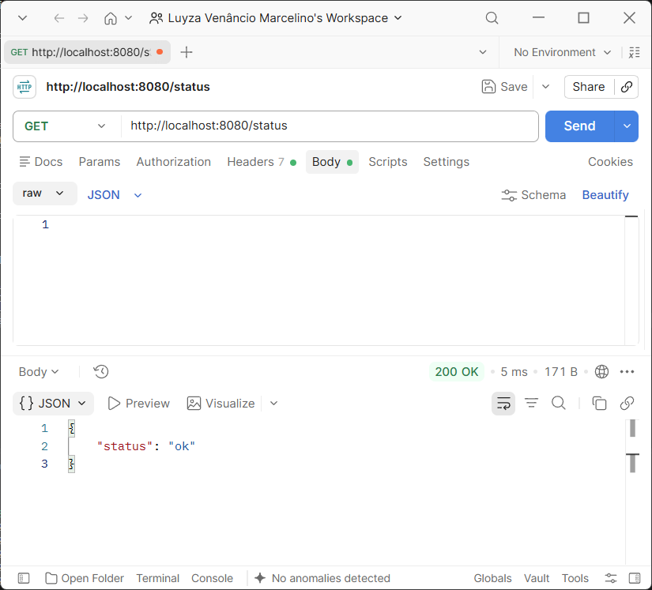
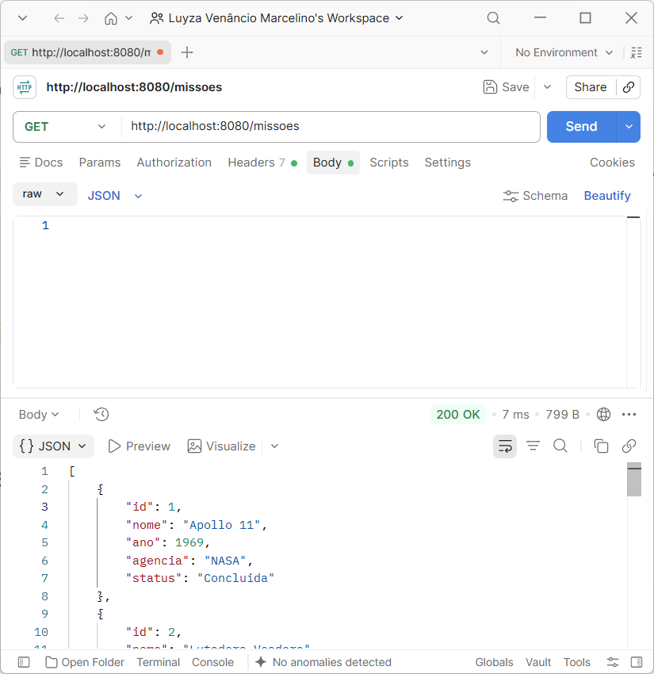
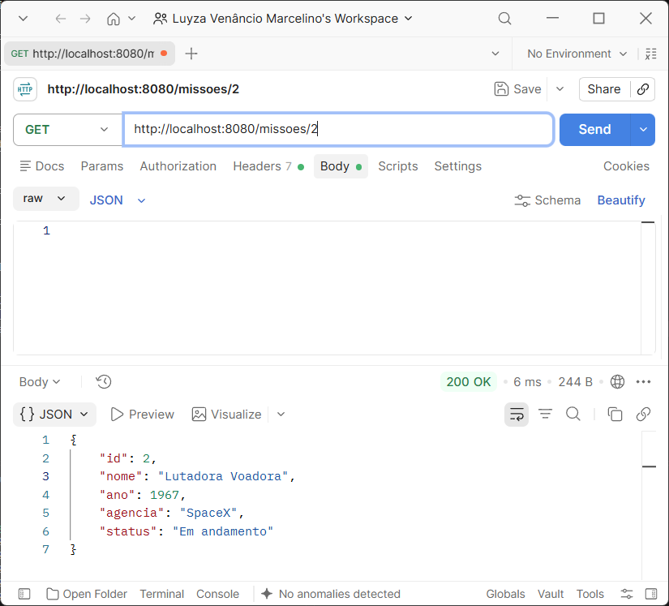
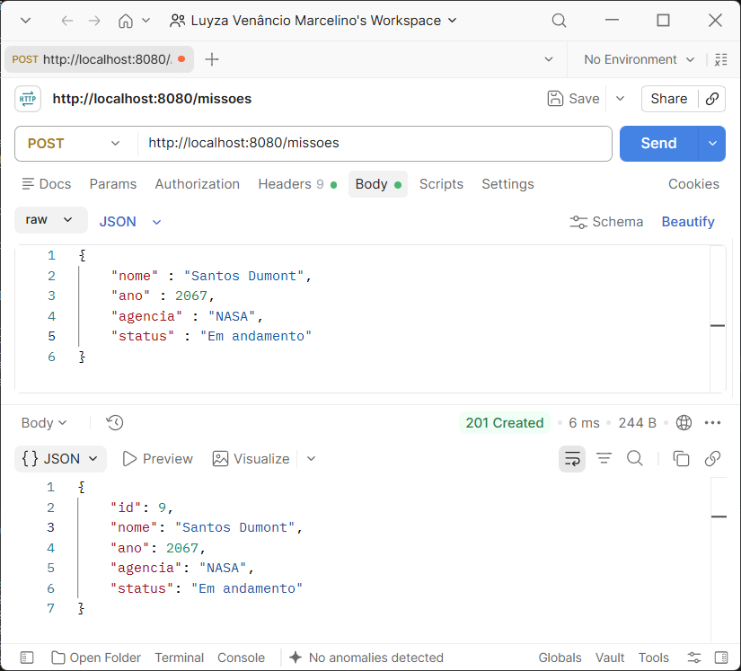
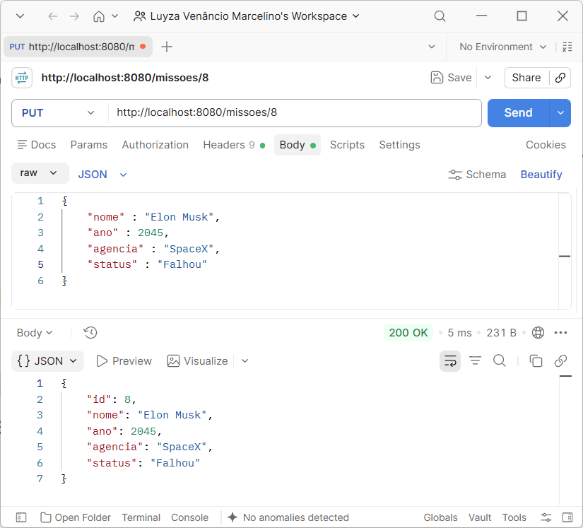
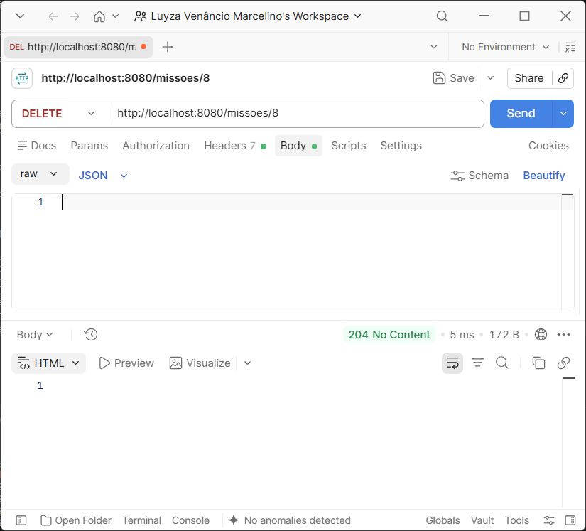

Nome: Luyza Venâncio Marcelino
Curso: Informática para Internet
UC: Desenvolver Serviços Web

Esse projeto individual se baseia em uma API gerenciadora de missões espaciais, capaz de pesquisar, cadastrar, atualizar e deletar missões.

Foram utilizadas as tecnologias:
- PHP
- Slim Framework
- Composer
- JSON

Para clonar esse projeto, você deve entrar no app Windows Powershell e digitar:
- git clone https://github.com/luyzaaaaav/prova.git

Para instalar as dependências deste projeto, você deve entrar no terminal VSCode ou Windows Powershell e digitar:
- composer require slim/slim
e
- composer require slim/psr7

Para executar este projeto, você deve entrar no terminal VSCode ou Windows Powershell e digitar:
- php -S localhost:8080 -t public

Testes do projeto:

- URL: localhost:8080/status
- Objetivo: Verificar se o status está ok.
- Ex. de Requisição: GET /status
- Ex. de Resposta: { "status" : "ok" }

- URL: localhost:8080/missoes
- Objetivo: Pesquisar todas as missões cadastradas.
- Ex. de Requisição: GET /missoes
- Ex. de Resposta: 
[
    {
        "id": 1,
        "nome": "Apollo 11",
        "ano": 1969,
        "agencia": "NASA",
        "status": "Concluida"
    },
    {
        "id": 2,
        "nome": "Lutadora Voadora",
        "ano": 1967,
        "agencia": "SpaceX",
        "status": "Em andamento"
    },
    {
        "id": 3,
        "nome": "Voyager 1",
        "ano": 1977,
        "agencia": "NASA",
        "status": "Concluida"
    },
    {
        "id": 4,
        "nome": "Mars Pathfinder",
        "ano": 1996,
        "agencia": "NASA",
        "status": "Concluida"
    },
    {
        "id": 5,
        "nome": "Artemis I",
        "ano": 2022,
        "agencia": "NASA",
        "status": "Concluida"
    },
    {
        "id": 6,
        "nome": "Starship",
        "ano": 2023,
        "agencia": "SpaceX",
        "status": "Em andamento"
    },
    {
        "id": 7,
        "nome": "Juno",
        "ano": 2011,
        "agencia": "NASA",
        "status": "Em andamento"
    },
    {
        "id": 8,
        "nome": "Perseverance",
        "ano": 2020,
        "agencia": "NASA",
        "status": "Em andamento"
    }
]

- URL: localhost:8080/missoes/2
- Objetivo: Pesquisar a missão com id 2.
- Ex. de Requisição: GET /missoes/2
- Ex. de Resposta: 
{
    "id": 2,
    "nome": "Lutadora Voadora",
    "ano": 1967,
    "agencia": "SpaceX",
    "status": "Em andamento"
}

- URL: localhost:8080/status
- Objetivo: Cadastrar uma nova missão.
- Ex. de Requisição: POST /missoes
{
    "nome": "Santos Dumont",
    "ano": 2067,
    "agencia": "NASA",
    "status": "Em andamento"
}

- Ex. de Resposta:
{
    "nome": "Santos Dumont",
    "ano": 2067,
    "agencia": "NASA",
    "status": "Em andamento"
}

- URL: localhost:8080/status
- Objetivo: Atualizar a missão cadastrada com id 8.
- Ex. de Requisição: PUT /missoes/8
{
    "nome" : "Elon Musk",
    "ano" : 2045,
    "agencia" : "SpaceX",
    "status" : "Falhou"
}

- Ex. de Resposta:
{
    "nome" : "Elon Musk",
    "ano" : 2045,
    "agencia" : "SpaceX",
    "status" : "Falhou"
}

- URL: localhost:8080/status
- Objetivo: Deletar a missão cadastrada com id 8.
- Ex. de Requisição: DELETE /missoes/8
- Ex. de Resposta: 1